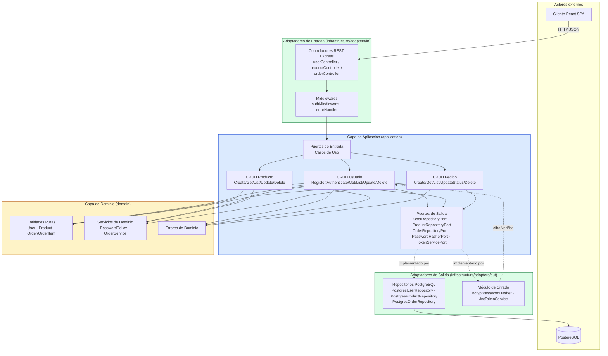

# Diagrama Arquitectónico — Backend (Arquitectura Hexagonal)

El backend sigue el patrón **Ports & Adapters (Hexagonal)**: el dominio no
depende de ningún framework, y toda comunicación con el exterior (HTTP,
PostgreSQL, bcrypt, JWT) pasa por interfaces (puertos) implementadas por
adaptadores intercambiables.



## Regla de dependencia

```
Adaptadores de Entrada  →  Aplicación (Puertos de Entrada)  →  Dominio
Adaptadores de Salida   →  implementan → Puertos de Salida  ←  Aplicación
```

El **Dominio** (entidades + servicios + errores) no importa Express, `pg`,
`bcrypt` ni `jsonwebtoken`. Toda esa infraestructura vive exclusivamente en
`infrastructure/adapters/*` y se conecta mediante el **contenedor de
inyección de dependencias** (`infrastructure/config/container.js`), que es
el único punto del sistema donde se instancian implementaciones concretas.

## Estructura de carpetas del backend

```
backend/src/
├── domain/
│   ├── entities/        User.js, Product.js, Order.js
│   ├── services/        PasswordPolicy.js, OrderService.js
│   └── errors/          DomainErrors.js
├── application/
│   ├── ports/
│   │   ├── in/           (contratos de casos de uso, implícitos en usecases/)
│   │   └── out/          UserRepositoryPort.js, ProductRepositoryPort.js,
│   │                     OrderRepositoryPort.js, PasswordHasherPort.js,
│   │                     TokenServicePort.js
│   └── usecases/
│       ├── user/         RegisterUserUseCase.js, AuthenticateUserUseCase.js, ...
│       ├── product/       CreateProductUseCase.js, ...
│       └── order/         CreateOrderUseCase.js, ...
└── infrastructure/
    ├── adapters/
    │   ├── in/http/       controllers/, routes/, middlewares/
    │   └── out/
    │       ├── persistence/postgres/  PostgresUserRepository.js, ...
    │       └── security/               BcryptPasswordHasher.js, JwtTokenService.js
    └── config/            db.js, container.js
```

## Seguridad de credenciales

- La contraseña en texto plano **nunca se persiste**: se valida con
  `PasswordPolicy` (regla de dominio) y se transforma en hash mediante
  `BcryptPasswordHasher` (12 salt rounds) antes de construir la entidad `User`.
- `User.toSafeObject()` es la única forma en que un usuario sale hacia HTTP;
  excluye `passwordHash` explícitamente.
- La autenticación expide un JWT firmado (`JwtTokenService`) que el
  frontend adjunta como `Authorization: Bearer <token>` en cada petición.
- `authMiddleware` valida el token y `requireRole` restringe operaciones
  administrativas (crear/editar/eliminar productos, gestionar usuarios,
  cambiar estado de pedidos).
