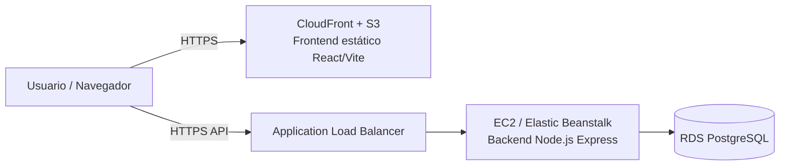

# Guía de Despliegue en AWS (al activar el laboratorio)

Esta guía asume un laboratorio AWS Academy/Educate típico: una cuenta con
permisos acotados, sin acceso a IAM completo, y credenciales temporales que
expiran. Ajusta según los servicios habilitados en tu laboratorio.

## Arquitectura de despliegue sugerida



## 1. Base de datos: Amazon RDS (PostgreSQL)

1. Al activar el laboratorio, entra a **RDS → Create database**.
2. Motor: PostgreSQL (misma versión mayor que usaste localmente).
3. Plantilla: Free tier / dev-test (según lo que permita el lab).
4. Configura usuario maestro y contraseña (guárdalos, se usarán en `.env`).
5. En **Connectivity**, coloca la instancia en el mismo VPC que usará el
   backend, y limita el Security Group para permitir el puerto `5432`
   únicamente desde el Security Group del backend (no desde `0.0.0.0/0`).
6. Una vez disponible, conéctate y aplica el esquema:
   ```bash
   psql -h <endpoint-rds>.rds.amazonaws.com -U <usuario_maestro> -d postgres \
        -c "CREATE DATABASE ecommerce;"
   psql -h <endpoint-rds>.rds.amazonaws.com -U <usuario_maestro> -d ecommerce \
        -f backend/database/schema.sql
   ```

## 2. Backend: EC2 (opción simple) o Elastic Beanstalk (opción gestionada)

### Opción A — EC2 manual
1. Lanza una instancia EC2 (Amazon Linux 2023 o Ubuntu), tipo `t2.micro`/`t3.micro`.
2. Security Group: abre el puerto `3000` (o el que definas) solo al ALB o a
   tu IP para pruebas; el puerto `22` solo a tu IP.
3. Conéctate por SSH e instala Node.js (nvm, igual que en WSL).
4. Sube el código (`git clone` o `scp`) y copia `.env.example` a `.env`
   con los valores reales: `DB_HOST` = endpoint de RDS, `DB_PASSWORD`,
   `JWT_SECRET` (genera uno nuevo y distinto al de desarrollo).
5. Instala dependencias y ejecuta con un gestor de procesos:
   ```bash
   npm install --production
   npm install -g pm2
   pm2 start src/server.js --name ecommerce-api
   pm2 startup && pm2 save
   ```
6. (Recomendado) Coloca un Application Load Balancer delante de la
   instancia (o de un Auto Scaling Group) para HTTPS con certificado ACM.

### Opción B — Elastic Beanstalk
1. `eb init` (elige plataforma Node.js) dentro de `backend/`.
2. Define las variables de entorno (`DB_HOST`, `DB_PASSWORD`, `JWT_SECRET`,
   `CORS_ORIGIN`) en **Configuration → Software → Environment properties**.
3. `eb create ecommerce-api-env` y luego `eb deploy` en cada actualización.

## 3. Frontend: S3 + CloudFront

1. Genera el build de producción localmente o en CI:
   ```bash
   cd frontend
   VITE_API_URL=https://<tu-api-publica>/api npm run build
   ```
2. Crea un bucket S3 (p.ej. `ecommerce-frontend-<tu-id>`), habilita
   "Static website hosting" o, mejor, sirve el bucket como origen privado
   detrás de CloudFront (Origin Access Control).
3. Sube el contenido de `frontend/dist/`:
   ```bash
   aws s3 sync dist/ s3://ecommerce-frontend-<tu-id> --delete
   ```
4. Crea una distribución CloudFront apuntando al bucket, con "Default root
   object" = `index.html`, y una regla de error 403/404 → `index.html`
   (necesario porque React Router maneja rutas en el cliente).
5. Actualiza `CORS_ORIGIN` en el backend con el dominio de CloudFront.

## 4. Variables de entorno en el laboratorio

Como las credenciales del laboratorio suelen expirar, evita hardcodear
secretos: usa **AWS Systems Manager Parameter Store** (si está disponible
en el lab) para `DB_PASSWORD` y `JWT_SECRET`, y léelos al iniciar la
instancia, o al menos mantenlos fuera del repositorio (`.env` en
`.gitignore`, ya incluido).

## 5. Checklist antes de dar por cerrado el despliegue

- [ ] RDS accesible solo desde el Security Group del backend.
- [ ] `JWT_SECRET` distinto al usado en desarrollo local.
- [ ] HTTPS habilitado en la entrada pública (ALB/CloudFront + ACM).
- [ ] `CORS_ORIGIN` apunta exactamente al dominio del frontend desplegado.
- [ ] `npm run build` del frontend usa la URL pública de la API, no `localhost`.
- [ ] Prueba end-to-end: registro, login, creación de producto (admin),
      creación de pedido, verificación de descuento de stock.

> Nota: los nombres exactos de servicios y límites del laboratorio (créditos,
> duración de sesión, servicios habilitados) dependen de la plataforma que
> uses (AWS Academy Learner Lab, AWS Educate, etc.). Ajusta los pasos según
> lo que el laboratorio active para tu cuenta.
